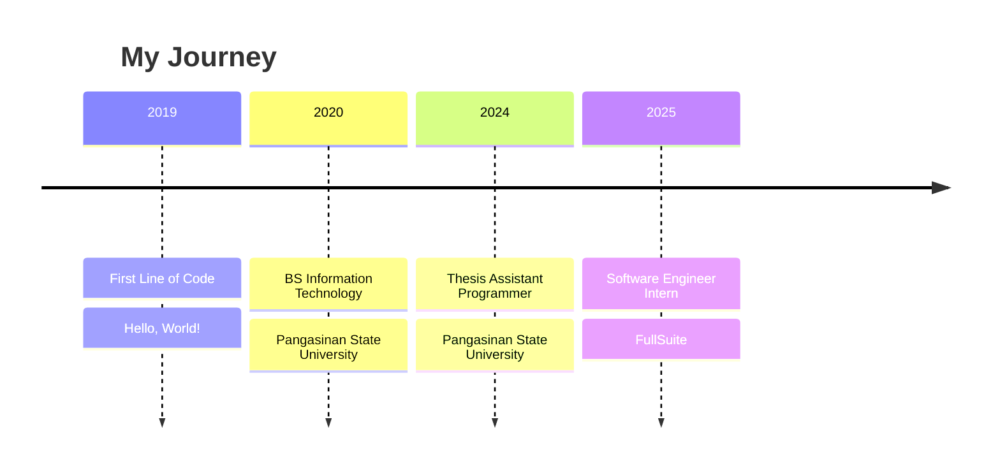

<!-- ===================== HEADER ===================== -->
<div align="center">


<a href="https://github.com/jrmmllrs">
  
</a>

<br/>


<br/><br/>

[](mailto:jmillares0945@gmail.com)
[](https://linkedin.com/in/jrmmllrs)
[](https://vercel.com/jeromes-projects-1b97e0bd)
[](https://calendly.com/jmillares0945/30min)

</div>

<br/>

<!-- ===================== ABOUT ===================== -->
## 👋 About Me

I'm a **Software Engineer Intern** at **FullSuite**, working with **React.js** and **Node.js** to build and improve modern web applications. I built my foundation at **Pangasinan State University**, where I learned Python, Flutter, PHP, Laravel, and Tailwind CSS, and how to turn ideas into working software.

I'm always improving my coding practices and exploring new technologies, so I can contribute to real-world projects and team goals.

```yaml
name:      Jerome Millares
role:      Software Engineer Intern @ FullSuite
education: BS Information Technology, Pangasinan State University
focus:     Web Development, Generative AI
learning:  LLM apps, prompt engineering, AI-powered products
vibe:      curious, reliable, always improving
```

<br/>

<!-- ===================== TECH STACK ===================== -->
## 🛠️ Tech Stack

<div align="center">

<table>
<tr>
<td align="center" width="140"><b>Frontend</b></td>
<td>

</td>
</tr>
<tr>
<td align="center"><b>Backend</b></td>
<td>

</td>
</tr>
<tr>
<td align="center"><b>Mobile</b></td>
<td>

</td>
</tr>
<tr>
<td align="center"><b>Database</b></td>
<td>

</td>
</tr>
<tr>
<td align="center"><b>DevOps &amp; Cloud</b></td>
<td>

</td>
</tr>
<tr>
<td align="center"><b>Tools</b></td>
<td>

</td>
</tr>
</table>

</div>

<br/>

<!-- ===================== FEATURED PROJECTS ===================== -->
## 🚀 Featured Projects

<table>
<tr>
<td width="50%" valign="top">

### ☕ [CafeNova](https://coffee-shop-frontend.vercel.app)
**Point-of-Sale System for Coffee Shops**

A complete solution built to streamline operations and improve customer service in coffee shop environments.


[🔗 Live Demo](https://coffee-shop-frontend.vercel.app)

</td>
<td width="50%" valign="top">

### 🦷 [Dental Booking System](https://diego-dental.vercel.app)
**Appointment Management Platform**

A scheduling and booking system built specifically for dental clinic workflows.


[🔗 Live Demo](https://diego-dental.vercel.app)

</td>
</tr>
<tr>
<td width="50%" valign="top">

### 🏢 [SuiteLifer](https://suitelifer.com)
**Collaborative Development Project**

Contributed to the development and implementation of key features.


[🔗 Visit Site](https://suitelifer.com)

</td>
<td width="50%" valign="top">

### 👥 [Application Tracking System](https://ats.kriyahr.com)
**Recruitment Management Solution**

Collaborated on improving functionality and user experience for HR recruitment processes.


[🔗 Visit Site](https://ats.kriyahr.com)

</td>
</tr>
<tr>
<td colspan="2" valign="top">

### 📝 [TsekSuite](https://fullsuite.tseksuite.com/)
**Quiz / Test Platform for Applicants and Employees**


[🔗 Visit Site](https://fullsuite.tseksuite.com/)

</td>
</tr>
</table>

<br/>

<!-- ===================== EXPERIENCE ===================== -->
## 💼 Experience & Education



<details>
<summary><b>📋 View as table</b></summary>
<br/>

| Year | Role | Organization |
|:----:|------|--------------|
| 2025 | Software Engineer Intern | FullSuite |
| 2024 | Thesis Assistant Programmer | Pangasinan State University |
| 2020 | BS Information Technology | Pangasinan State University |
| 2019 | First Line of Code | Hello World! |

</details>

<br/>

<!-- ===================== CERTIFICATIONS ===================== -->
## 🏆 Certifications

<div align="center">


</div>

<br/>

<!-- ===================== TESTIMONIALS ===================== -->
## 💬 What People Say

> *"He's the kind of developer who doesn't just code — he finds better ways to build things. Reliable, curious, and always improving."*
>
> **Jun Jun Zaragosa** · Software Engineer Lead at FullSuite

> *"Working with him was a game-changer for our project. His attention to detail and problem-solving skills are exceptional."*
>
> **Angel Hamelton Yacapin** · Software Engineer at FullSuite

<br/>

<!-- ===================== GITHUB STATS ===================== -->
## 📊 GitHub Stats

<div align="center">


<br/>


<br/>


</div>

<br/>

<!-- ===================== CONTRIBUTION GRAPH ===================== -->
## 📈 Contribution Graph

<div align="center">


</div>

<br/>

<!-- ===================== CTA ===================== -->
## 🤝 Let's Connect

I'm open to internships, collaborations, and conversations about web development and Generative AI. Feel free to reach out!

<div align="center">

[](mailto:jmillares0945@gmail.com)
[](https://linkedin.com/in/jrmmllrs)
[](https://calendly.com/jmillares0945/30min)

<br/>


</div>
